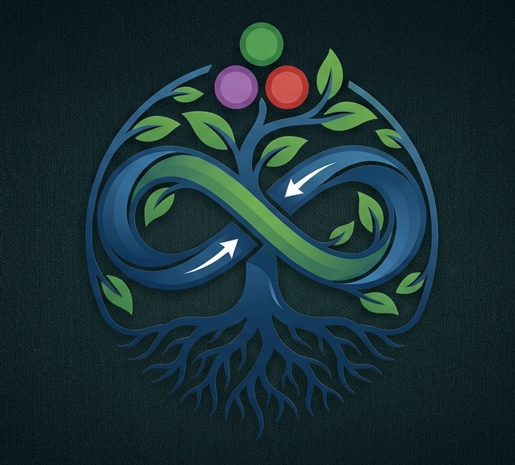
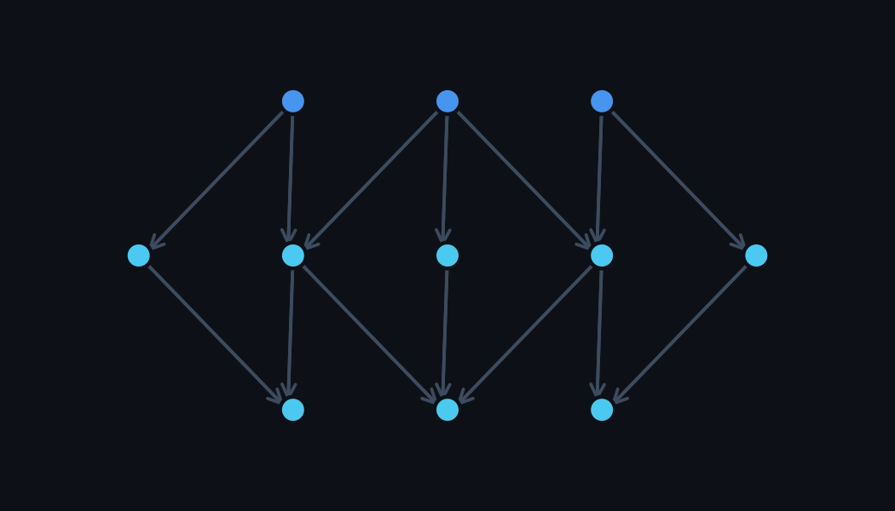
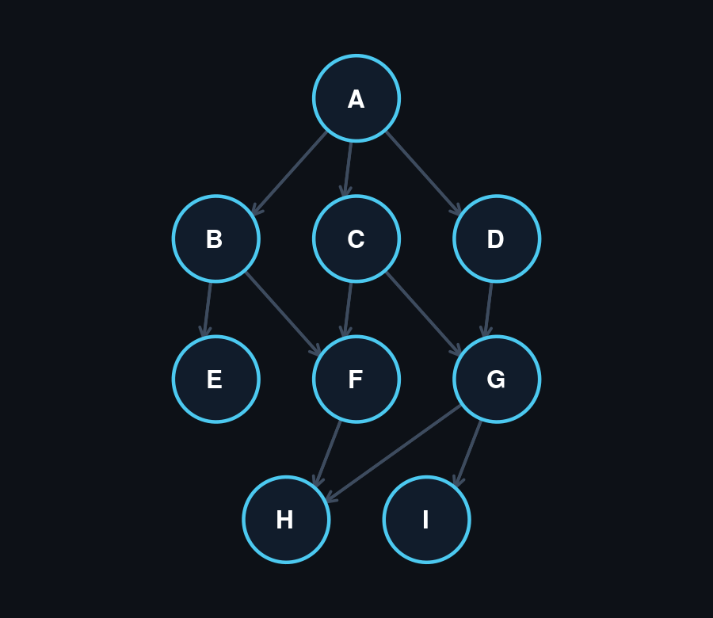
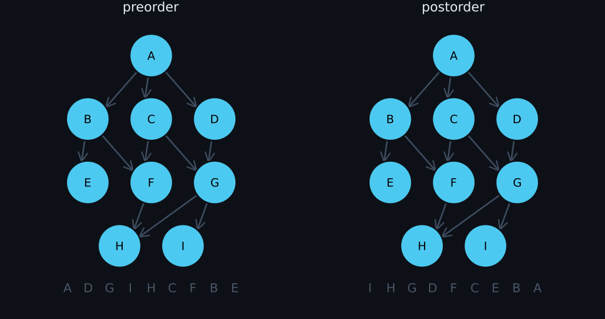
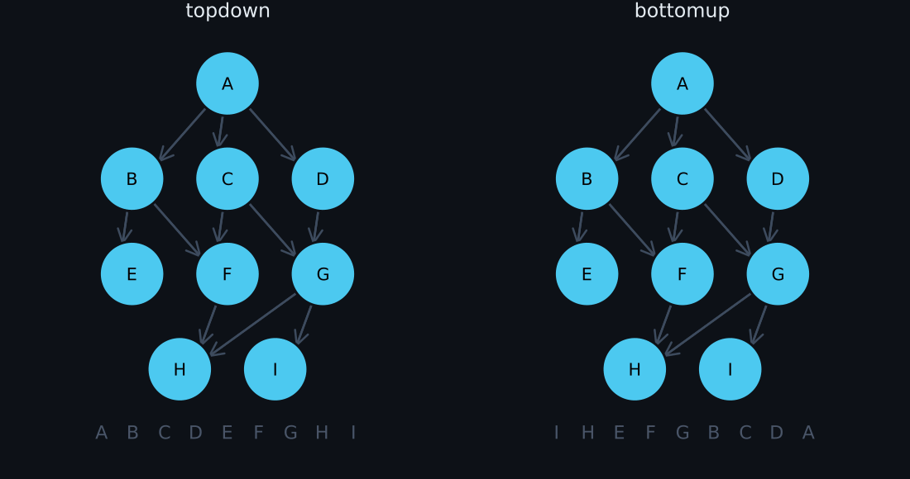
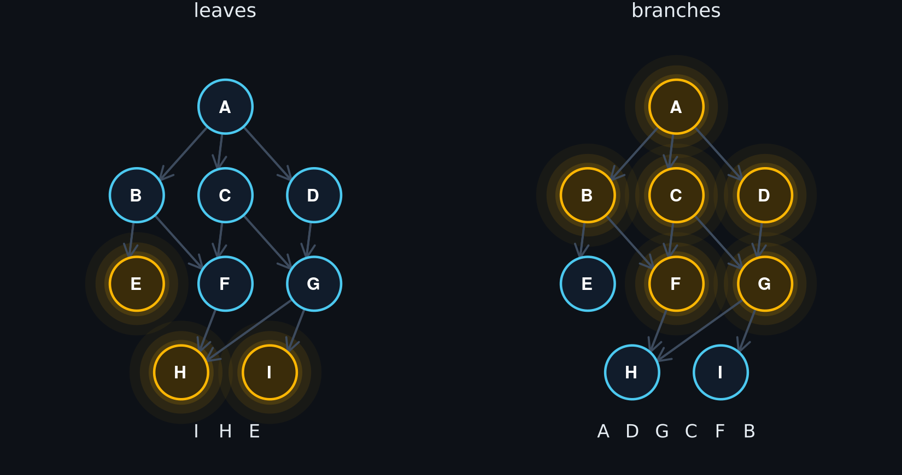

```@raw html
<p align="center">
  
</p>
<h1 align="center">Taproots.jl</h1>
```

This library helps you traverse nested structs and data (including your own custom ones) in easy peasy ways! 
This library is inspired by `AbstractTrees.jl` and provides an abstract interface which you can plug into any struct and get going (you can also skip the interface and provide a function on demand). 

For the purposes of this package, we'll consider *any* struct a taproot if:

- It has nested data which can be accessed from the struct in some way (whether by using keys or by actually holding that data -- you'll provide the function to do that)
- That nested data forms a Directed Acyclic Graph (DAG) (although this package can handle cycles)

Many structures in the world form taproots:

- File and folder structures (potentially including symlinks)
- Nested data structures such as JSON, YAML, and so on. Nested Julia Dicts also do this.
- A response variable with all its causally-related covariates. 

This package provides a few lightweight tools so you don't need to write custom recursions each time. 

Worth a quick note that a taproot in this package is not quite as general as a DAG -- with the main difference being that a taproot has only one root node, and all other nodes eventually connect to that root node. This is a key feature of this package. Instead of creating an adjacency matrix from your data and then converting that to a `DAG(matrix)` and then writing `preorder(DAG)` ... you can just `preorder(your_data)` right off the bat.

That being said, this API can still handle multiple root nodes. You can simply call `preorder(node1, node2, node3, ...)` and it will iterate through all those nodes at the same time, and (by default) only visit the overlapping nodes once. 



## Installation 

In the Julia REPL, type `]` and then `add Taproots`.

## How to use

Turn your own struct into a taproot by telling Taproots how to find its children:

```julia
using Taproots

mutable struct MyType 
	some_data
	children
end

Taproots.children(x::MyType) = x.children 
Base.show(io::IO, x::MyType) = print(io, x.some_data)
```

`Taproots.children` is a function, so you don't have to store the children: you can look them up from a key or anywhere else.

That's it. Your struct now works with (almost) everything in `Taproots.jl`. 

Let's build a small DAG. `F`, `G` and `H` each have more than one parent:

```julia
H = MyType("H", []); E = MyType("E", []); I = MyType("I", [])
F = MyType("F", [H]); G = MyType("G", [H, I])
B = MyType("B", [E, F]); C = MyType("C", [F, G]); D = MyType("D", [G])
A = MyType("A", [B, C, D])
```



Now you might wish to traverse ALL that data in a lazy way:

```julia 
for node in postorder(A)
	println(node)
end
```

Or just the things at the edges:

```julia 
for node in leaves(A)
	println(node)
end
```

## Walks

Every walk is a lazy iterator, so `map`, `Iterators.filter`, `first` and `collect` all work. 
In the animations, the amber path is the route from the root to the node being visited.

### Depth-first

```julia
preorder(A)   # A D G I H C F B E   (parents before children)
postorder(A)  # I H G D F C E B A   (children before parents)
```



!!! note
	Depth-first walks take the rightmost child first.

### Breadth-first

```julia
topdown(A)   # A B C D E F G H I   (level by level, from the root)
bottomup(A)  # I H E F G B C D A   (every child before its parents: a topological sort)
```



`bottomup` is the one eager walk: it maps the taproot before yielding anything.

### Leaves and branches

```julia
leaves(A)    # I H E          (nodes without children)
branches(A)  # A D G C F B    (nodes with children)
```



### Leaf batches

```julia
leafbatches(A)  # [I, H, E], [F, G], [B, C, D], [A]
```

Each batch only depends on earlier batches, so the nodes inside one batch can be processed in parallel.

## Shaping a walk

Every walk above takes the same keyword arguments.

### How often a node is visited: `pathset`

```julia
preorder(A; pathset = OncePerNode)  # A D G I H C F B E              (the default)
preorder(A; pathset = OncePerEdge)  # A D G I H C G F H B F E        (once per parent)
preorder(A; pathset = NoCycles)     # A D G I H C G I H F H B F H E  (every path, cycles cut)
preorder(A; pathset = AllPaths)     # A D G I H C G I H F H B F H E  (every path)
```

- `OncePerNode`: each node once, however many paths lead to it.
- `OncePerEdge`: each parent-child edge once.
- `NoCycles`: every path, but never back into a node's own ancestors.
- `AllPaths`: every path. The fastest, since nothing is tracked, but it never finishes on a cyclic taproot.

### Which children to follow: `connector`

`connector(node, child)` decides whether the walk steps from `node` into `child`:

```julia
preorder(A; connector = (node, child) -> child !== G)  # A D C F H B E
```

`isleaf`, `isbranch`, `leaves` and `branches` respect the connector too.

### What each step yields: `eltype`

Ask for `Node` (the default), `Level` (depth from the root), `Trace` (the child indices leading to the node), or a tuple of them:

```julia
preorder(A; eltype = (Node, Level))  # (A, 0), (D, 1), (G, 2), (I, 3), ...
preorder(A; eltype = Trace)          # (), (3,), (3, 1), (3, 1, 2), ...
```

`traces(A)` and `tracepairs(A)` are shorthands for `preorder(A; eltype = Trace)` and `preorder(A; eltype = (Trace, Node))`.

### Children on demand

Pass a `children` function first to skip the interface entirely (or to override it for one walk):

```julia
preorder(n -> reverse(n.children), A)  # A B E F H C G I D
```

### Several roots

```julia
preorder(B, D)  # D G I H B F E   (H is shared, but visited once)
```

## Interface

`Taproots.children` is all you need to walk. A few more functions describe your nodes:

```julia
childtype(MyType)  # the eltype of children(::MyType)
childtypes(A)      # a guess at the union of every node type in the taproot

ischild(H, C)   # true: H is (recursively) a child of C
isparent(D, E)  # false: E can't be reached from D
isleaf(E)       # true: no children
isbranch(A)     # true: has children
```

To modify taproots in place (with `tapmap!`, `prune!` and friends; see [Extras](extras.md)), also define:

```julia
Taproots.data(node::MyType) = node.some_data                              # the data a node holds, apart from its children
Taproots.setdata!(node::MyType, data) = (node.some_data = data; node)    # must return the node
Taproots.setchildren!(node::MyType, children) = (node.children = children; node)  # must return the node
```

`setdata!(node, data(node))` and `setchildren!(node, children(node))` should both leave `node` unchanged.

See [Extras](extras.md) for modification, searching, built-in taproots and visualisation.
